# APM — Adaptive Process Management

### Manifesto v4.1 — Architettura protocol-oriented per la collaborazione Human-Agent

> **Come è organizzato questo documento.** Per servire lettori diversi con un unico testo, il manifesto è ora strutturato su tre livelli di profondità: un **Executive Summary** (~2 min di lettura) per chi deve capire il valore e la portata di APM; un **Corpo Principale** con la visione, l'architettura e i concetti che ogni stakeholder tecnico o di governance deve conoscere; e un'**Appendice Tecnica** in coda, dove risiedono i dettagli implementativi più fitti (ramificazioni/rollback, strategie di storage dei delta, riferimenti agli standard). Nessun contenuto è stato rimosso: è stato solo ridistribuito per livello di lettura.

---

## Executive Summary

APM (Adaptive Process Management) è un protocollo di tracciamento dei processi aziendali — non un'invenzione da zero, ma la sintesi di pattern già consolidati e maturi: la separazione del contenuto tipica dei sistemi a schema dinamico, il principio di stato immutabile e versionato dell'*event sourcing*, i criteri di elasticità e resilienza del *Reactive Manifesto*, e il modello di provenienza *entity–activity–agent* di **W3C:PROV-O**. APM risponde a una domanda semplice ma cruciale per ogni organizzazione che integra persone e agenti AI nei propri flussi di lavoro: **chi ha fatto cosa, su cosa, quando e con quale autorità.**

L'infrastruttura poggia su **tre grafi complementari**:

- **Actor Metagraph** — la *ground truth* di identità, permessi (RBAC/ABAC) e ownership;
- **Process Metagraph** — il cuore del protocollo, oggetto di questo manifesto: il lineage immutabile e append-only che traccia l'evoluzione dei processi, cosa è stato consumato o prodotto, e chi lo ha eseguito;
- **Memory Metagraph** — lo strato logico-procedurale che cataloga il *perché* delle decisioni e il *come* delle procedure applicate.

Il valore di business è duplice. Da un lato, APM fornisce un audit trail assoluto e non ripudiabile per ogni azione — umana o agentica — con piena tracciabilità di deleghe, esecuzioni concorrenti e rollback, riducendo il rischio operativo e semplificando la compliance normativa (incluso il GDPR). Dall'altro, separa nettamente ciò che è fisso nel protocollo (due sole primitive: **Process** ed **Entity**) da ciò che è specifico di ogni reparto (schemi di dominio evolutivi), permettendo a ogni funzione aziendale — HR, Finance, Prodotto, Sviluppo — di adottare lo stesso protocollo senza mai dover coordinare modifiche al core.

È altrettanto importante chiarire cosa APM **non è**: non è un nuovo database, non è un nuovo linguaggio di modellazione dati, e non nasce come architettura isolata. È un layer di coordinamento leggero che riutilizza e ricompone standard esistenti, lasciando al manuale tecnico le scelte implementative (motore a grafo, storage, chiavi di protocollo).

Questo documento presenta prima la visione e l'architettura a livello manageriale/strategico; i dettagli implementativi più fitti sono raccolti in **Appendice Tecnica**, in coda al file, per chi debba progettare o auditare il sistema nel dettaglio.

---

## 0. Visione

APM è l'infrastruttura di supporto ai processi aziendali: un protocollo unico, leggero ed estendibile che traccia **chi ha fatto cosa, su cosa, perché e come**, in ogni reparto, per ogni collaborazione tra persone e agenti AI.

Non è un'invenzione da zero, sfrutta standard esistenti e li mette insieme in modo unico: la separazione del contenuto per sistemi a schema dinamico, l'idea di stato immutabile e versionato (event sourcing), i principi di elasticità e resilienza del *Reactive Manifesto*, e il modello di provenienza *entity–activity–agent* di **W3C:PROV-O**, ridefinito qui come **Entity–Process–Actor**.

Il risultato è un **metamodello fisso nelle sue regole invarianti, ma a schema evolutivo per la semantica di dominio**: poche regole compilate nel core, sopra le quali ogni reparto costruisce e fa evolvere i propri modelli dati tramite schemi registrati, senza mai toccare il protocollo.

---

## 1. Filosofia di design: struttura fissa, semantica evolutiva

APM non definisce anzitutto "la forma di un nodo del grafo": definisce un **protocollo di comunicazione ad alto livello**, espresso tramite tre nuclei informativi concettuali — **L1, L2, L3** — che si applicano in modo identico, senza bisogno di uno schema separato, a tre casi d'uso distinti:

1. **Pacchetti di comunicazione** — il formato con cui un sistema esterno (un `EventHandler`, un job scheduler, un altro modulo aziendale) invia una richiesta di azione verso il protocollo.
2. **Contenuto per eventi e direttive/operazioni** — il corpo informativo che descrive un intento operativo (es. "crea questo Process", "fai avanzare questo Process con `SUPERSEDES`", "collega questa Entity"), a prescindere dal canale con cui viaggia.
3. **Informazioni del grafo da persistere nel DB** — la forma finale con cui il nodo/arco viene scritto e reso interrogabile nel Process Metagraph.

È importante distinguere qui il **Modello Dati Concettuale** dal **Modello Implementativo**: L1/L2/L3 sono nuclei concettuali invarianti — cosa deve sempre essere presente e con quale grado di rigidità — non una prescrizione su quale tecnologia di storage, message broker o formato di serializzazione li debba realizzare. Il *come* implementarli (database a grafo, code di messaggistica, formati di serializzazione) resta compito del manuale tecnico; il manifesto fissa solo l'invariante concettuale.

Ogni nodo — o pacchetto — è composto da tre livelli. Solo il primo è "compilato" nel protocollo; gli altri sono validati a runtime contro uno schema registrato — aggiungere o aggiornare un dominio non tocca mai il core.

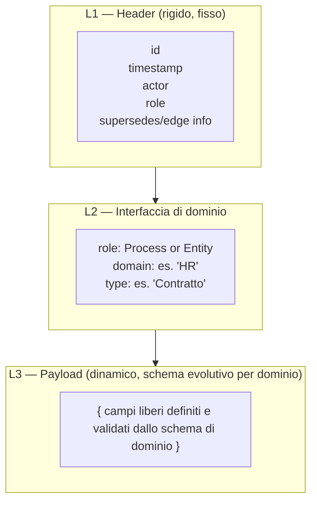

* **L1 — Header rigido:** identico in ogni caso d'uso (comunicazione, evento/direttiva, persistenza). Contiene i campi invarianti (`id`, `timestamp`, `actor`, `role`, informazioni sull'arco). È l'unica parte realmente "compilata" nel protocollo.
* **L2 — Interfaccia di dominio:** dichiara a quale dominio e tipo appartiene il pacchetto (`role: Process` o `Entity`, `domain`, `type`), permettendo al ricevente — sia esso il Control Plane in fase di persistenza, sia un altro sistema in fase di comunicazione — di sapere contro quale schema validare L3.
* **L3 — Payload dinamico:** il contenuto libero, validato a runtime contro lo schema di dominio registrato. Nel caso d'uso della persistenza a grafo, il payload L3 può contenere, in base alla strategia di dominio adottata, **un riferimento (`ref`) puntatore verso il Data Plane, oppure il contenuto inline**. L'opzione inline resta concettualmente sconsigliata per un protocollo di lineage puro: appesantisce il Control Plane con dati che non gli competono (§10) e va riservata a metadati compatti o a casi eccezionali normati dal dominio.

A livello compilato, `role` ammette **solo due valori primitivi**: `Process` o `Entity`. Nessun altro tipo di nodo esiste mai nel metamodello. Anche le dinamiche di concorrenza, delega e versioning (§7, §8) si appoggiano esclusivamente su nodi Process ed Entity.

> **Nota applicativa — Schema di dominio:** Il reparto HR definisce uno schema L3 per il tipo `Contratto` (campi: durata, RAL, clausole) e lo registra nel protocollo. Il reparto Finance, in parallelo, definisce il proprio schema per `Fattura`. Nessuno dei due tocca L1/L2: entrambi restano validi contro lo stesso header fisso, evolvendo autonomamente il proprio payload.

### Idempotenza contestuale sulle operazioni critiche

L'idempotenza non è un vincolo cieco applicato a qualsiasi scrittura, ma una **garanzia di protezione sulle operazioni sensibili o irreversibili** (es. approvazioni finanziarie, ordini di pagamento, emissioni di documenti ufficiali, notifiche vincolanti cross-dominio).

Per queste specifiche operazioni, l'applicazione reiterata dello stesso evento asincrono — causata da retry di rete o ridondanza agentica — non deve mai generare duplicazioni indesiderate di nodi o archi nel grafo. La distinzione tra una riesecuzione intenzionale di un comando e la duplicazione tecnica di un messaggio, così come le relative chiavi di deduplica, è gestita dagli Handler applicativi nel Data Plane; il manifesto stabilisce il principio che **il grafo di processo deve riflettere l'intenzione di business senza produrre effetti collaterali critici duplicati**.

---

## 2. Architettura a tre grafi

L'infrastruttura aziendale poggia su tre grafi distinti, ciascuno con una responsabilità unica. Solo il secondo — il **Process Metagraph** — è il cuore del protocollo APM; gli altri due sono pilastri dell'architettura che restano fuori dallo scopo tecnico del manifesto, implementabili liberamente dalle varie funzioni aziendali.

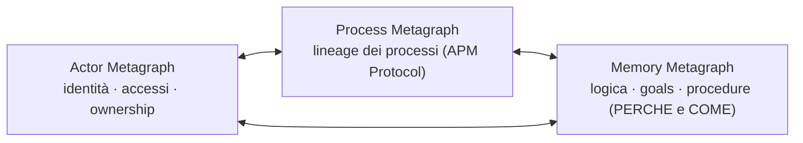

* **Actor Metagraph** — è la **Ground Truth** per identità, ruoli, permessi (RBAC/ABAC) e **ownership**. Determina chi ha l'autorità di eseguire o approvare un'azione.
* **Process Metagraph** — il grafo di *lineage*, oggetto di questo manifesto: traccia l'evoluzione degli stati, la provenienza degli output e la storia delle azioni eseguite. Risponde al **COSA** (cosa è stato fatto, cosa è stato usato, cosa è stato prodotto) e al **CHI** (quali attori umani e agentici hanno operato).
* **Memory Metagraph** — la base logica e procedurale dell'infrastruttura: rappresenta il **PERCHE** (scopi, goals, principi), il **COME** (logica applicata, skill, procedure) e il contesto decisionale che ha guidato le azioni tracciate nel Process Metagraph. È complementare e potenzialmente unificabile col Process Metagraph in un sistema interconnesso.

> **Esempi-base delle relazioni tra i tre grafi** *(illustrativi, non normativi — le primitive esatte di scambio restano da definire nel manuale tecnico):*
> - **Actor ↔ Process:** prima di scrivere un arco `SUPERSEDES`, il Control Plane verifica contro l'Actor Metagraph che l'attore abbia il permesso di operare su quel Process.
> - **Process ↔ Memory:** un Process può portare un riferimento esplicito a un Decision Point nella Memory Metagraph che ne motiva l'esito — perché è stato fatto in quel modo, con quale procedura — senza fondere i due grafi (§16).
> - **Actor ↔ Memory:** quando un principio o una procedura operativa viene modificata o versionata nella Memory Metagraph per uno specifico progetto, un `ApprovalHandler` richiede l'accettazione esplicita di un attore autorizzato (verificato contro l'Actor Metagraph) prima che la nuova versione del principio diventi effettiva.

### 2.1 Distinzione concettuale: Process vs Memory Metagraph

| Aspetto | Process Metagraph | Memory Metagraph |
| --- | --- | --- |
| **Responsabilità** | Traccia *cosa* è accaduto e *chi* lo ha fatto | Cataloga *perché* è accaduto e *come* è stato deciso |
| **Natura del dato** | Immutabile, append-only, cronologico | Evolutivo, procedurale, logico-contestuale |
| **Interrogazioni tipiche** | "Quale entità è stata usata?" "Chi ha eseguito questa azione?" "Quali step hanno portato a questo output?" | "Quale principio ha guidato questa decisione?" "Quale skill o procedura è stata applicata?" "Quale era l'intento del processo?" |
| **Uso in audit** | Traccia storica irrefutabile | Contesto e razionale delle decisioni |

**Unificazione potenziale**: Possono essere accorpati in modo parziale o totale in un sistema interconnesso, esempi di integrazione parziale o totale saranno poi presentati con vari tradeoff.

---

## 3. Glossario essenziale

| Termine | Significato |
| --- | --- |
| **Process Node** | Non un dato statico, ma la rappresentazione di un **agente esecutivo reattivo** in un istante *t* (equivalente a un'Activity PROV-O): è simultaneamente l'azione e il suo motore (codice, workspace, procedura in esecuzione). Il suo "corpo" — commit hash, ref di un job, versione di una procedura — non è un'Entity del grafo: è parte costitutiva del Process stesso, non un dato che consuma o produce. Immutabile: ogni cambio di stato crea un nuovo nodo. |
| **Entity Node** | Un dato (input, output o arricchimento) collegato a un Process tramite `USES` o `PRODUCED`. |
| **Process Edge (`SUPERSEDES`)** | L'arco primario che fa avanzare la linea temporale standard di un processo da uno stato al successivo. Traccia sia l'evoluzione dell'attività che l'evoluzione della logica che la governa (es. aggiornamento dello script, modifica di una codebase, o un workspace). Versiona il **Process**, non l'Entity: il versioning delle Entity è gestito separatamente dall'arco `REVISION_OF` (§8) |
| **Entity Edge (`USES` / `PRODUCED`)** | Collega una Entity a un Process: cosa è stato consumato, cosa è stato generato. |
| **Spawn Edge (`SPAWN`)** | Collega un Process all'esecuzione di un subprocesso delegato in background, compattato in un log unico. |
| **Fork Edge (`FORK`)** | Arco di ramificazione esplicita da un Process verso N branch concorrenti e isolati (traiettorie parallele). |
| **Join/Merge Edge (`JOIN`)** | Arco di convergenza che unisce N Entity prodotte da branch concorrenti in un'unica Entity finale dello stesso tipo delle sorgenti. Formalmente agisce come relazione N-a-1 (Hyperedge relazionale) per consolidare i risultati. |
| **Conflict Edge (`CONFLICT`)** | Arco che rende esplicita nel grafo una collisione tra scritture concorrenti incompatibili sulla stessa Entity logica. |
| **Derivation Edge (`DERIVED_FROM`)** | Proprietà di base che asserisce che un'entità è trasformata, aggiornata o costruita a partire da un'entità preesistente (es. un dataset ripulito derivato da uno grezzo). |
| **Versioning Edge (`REVISION_OF`)** | Proprietà più specifica, sotto-relazione stretta di `DERIVED_FROM`. Indica che un'entità è una versione rivista di un'entità precedente, tipicamente nei casi in cui le entità cambiano nel tempo mantenendo una linea evolutiva diretta. |
| **Actor** | Proprietà presente sull'arco che indica l'identità dell'esecutore che ha effettuato la scrittura. |
| **`acting_on_behalf_of`** | Proprietà opzionale sull'arco: indica l'attore per conto del quale è stata eseguita l'azione. |
| **Process Trajectory** | La catena ordinata di Process Node collegati da `SUPERSEDES`: rappresenta l'evoluzione del Process stesso e della logica esecutiva a cui è ancorato, non il versioning di un'Entity dati (gestito separatamente da `REVISION_OF`, §8). |

---

## 4. Attribuzione e Ownership: disaccoppiamento controllato

Il Process Metagraph resta **puro lineage storico**: traccia *chi ha eseguito* un'azione al tempo *t*, non chi *possiede* il processo nel presente.

Ogni arco porta con sé il riferimento all'`actor` che ha firmato la transazione. La titolarità legale o organizzativa del processo (**Ownership**) risiede esclusivamente nell'**Actor Metagraph** (Ground Truth).

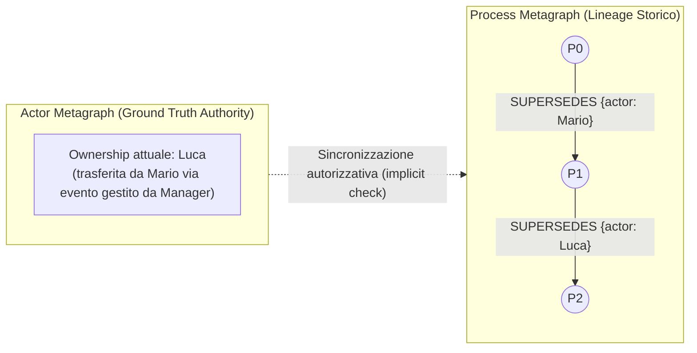

### Meccanismo di Sincronizzazione e Invarianti

1. **Trasferimento di Ownership:** Quando un manager o responsabile trasferisce la titolarità nell'Actor Metagraph, l'autorizzazione dell'utente precedente viene revocata alla fonte.
2. **Tracciabilità Implicita sul Grafo:** Il cambio si riflette nel Process Metagraph in modo naturale: l'arco successivo sarà firmato dall'`actor` del nuovo titolare.
3. **Invariante di Audit:** Il Process Metagraph è append-only. Gli eventi storici firmati dal vecchio attore rimangono immutabili e validi per l'audit passato; le nuove operazioni saranno consentite solo al nuovo titolare validato contro l'Actor Metagraph.

> **Nota applicativa — Trasferimento di ownership:** Un ticket di incident IT viene aperto da Marco (`actor: Marco`) e portato avanti tramite una catena di `SUPERSEDES`. Quando il ticket viene riassegnato a Giulia dal team lead, l'Actor Metagraph aggiorna l'ownership; il prossimo `SUPERSEDES` sarà firmato `actor: Giulia`. Gli archi storici firmati da Marco restano immutabili e consultabili in audit.

---

## 5. Supersession Graph

Prima di affrontare il caso complesso di §7.1 (dettagli in Appendice Tecnica A), vediamo la forma più semplice e intuitiva della *Process Trajectory*: una lunga catena orizzontale di Process, come i segmenti del corpo di un millepiede. La "colonna vertebrale" del millepiede è la sequenza dei `SUPERSEDES` (arco più spesso): rappresenta il tempo che avanza, un passo dopo l'altro. Da ogni segmento si diramano delle "zampe" — gli archi `USES`/`PRODUCED` (arco più sottile) — verso i dati che quel passo ha consumato o generato.

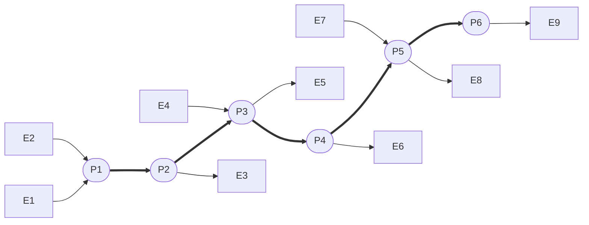

Non serve altro per capire il grafo di processo a livello macro:

- Ogni **quadrato Eᵢ** è un dato — un'Entity — usato o prodotto in un certo istante.
- Ogni **Pᵢ** è un passo del processo — un Process — al tempo *i*.
- Gli archi lungo la spina dorsale sono **sempre e solo** `SUPERSEDES`: non esiste altro modo di avanzare nel tempo.
- Le zampe sono **sempre e solo** `USES` o `PRODUCED`: non esiste altro modo per un processo di toccare un dato.

Sei passi, sei segmenti: qualunque sia la complessità reale dietro ogni Pᵢ (una persona, un agente, un intero team), **da lontano** il processo resta sempre leggibile come questa fila ordinata e senza cicli. È la stessa proiezione descritta più in dettaglio in §7 come Macro-Vista.

---

## 6. Ruoli contestuali delle Entity

Un'Entity non ha una tipologia rigida di utilizzo: il ruolo è strettamente relativo all'arco che la collega a un Process. Lo stesso oggetto dati può essere l'output di una fase di redazione e l'input di una fase di revisione senza subire alcuna riassegnazione strutturale.

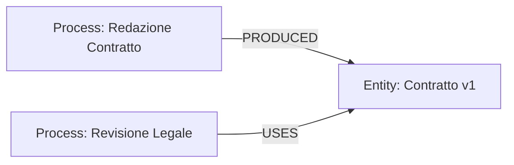

---

## 7. Tracciamento Agentico: la Proiezione a Solido DAG

La collaborazione con agenti AI richiede un modello flessibile che non vincoli l'orchestrazione a una forma rigida predefinita. **Non esiste il requisito di un lineage omogeneo**: l'infrastruttura si adatta a scenari che vanno dalla delega lineare semplice a complessi grafi di esecuzione concorrente.

Nonostante l'orchestrazione agentica introduca rami paralleli e convergenze, **il metamodello garantisce l'assenza assoluta di cicli temporali (Acyclic Flow)**.

### Proiezione per livelli di astrazione (Macro vs. Micro)

Per evitare che l'utente finale o il revisore di business vengano sommersi dalla complessità delle chiamate agentiche intermedie, APM applica il principio di **Proiezione del Grafo**:

1. **Macro-Vista (Linear Process Projection):** È la proiezione del Process Graph ottenuta rimuovendo il sotto-grafo raggiungibile a partire dagli archi `SPAWN` e `FORK` — ogni nodo e arco diramato da quei ponti viene eliminato dalla vista. Ciò che resta è un **DAG lineare e pulito**, composto solo da Process collegati da `SUPERSEDES` e dalle Entity terminali (`USES`/`PRODUCED`). Questo è il livello mostrato all'utente o all'auditor per validare il risultato di business (*"Cosa è stato fatto e da chi"*).
2. **Micro-Vista (Agentic Workflow Expansion):** I rami generati da `SPAWN` e `FORK` costituiscono la traccia di dettaglio. Vengono consultati o espansi **solo su richiesta esplicita** (es. controlli di conformità approfonditi, debugging da parte di AI Engineer, analisi di alignment degli agenti).

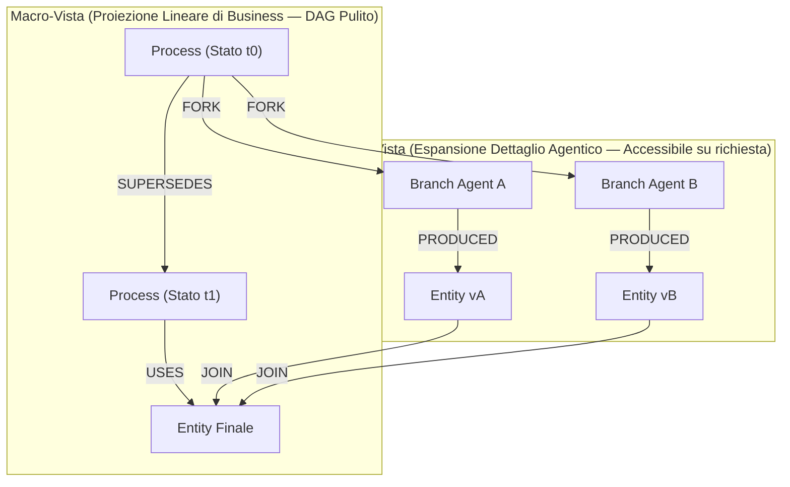

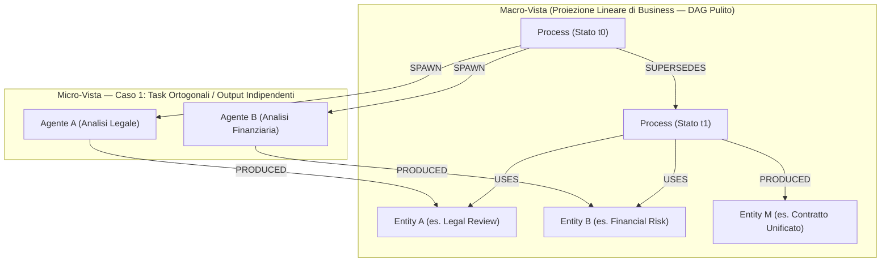

### Le Primitive di Delega e Concorrenza

* **`SPAWN` (Delega lineare compattata):** Usato quando un agente riceve un sotto-task delimitato. L'intera esecuzione interna (ragionamenti, tool calls) vive isolata ed è compattata in un log di esecuzione archiviato nel Data Plane. Il metagrafo vede un singolo nodo e l'Entity di output prodotta.
* **`FORK` (Concorrenza esplicita):** Usato quando l'orchestrazione richiede la ramificazione in traiettorie parallele visibili a livello di metagrafo. Ogni ramo opera in una propria **sandbox concettuale** elaborando una propria versione/ipotesi di lavoro in base al suo specifico goal.
* **`JOIN` (Convergenza relazionale / Hyperedge):** Quando i rami concorrenti debbono riconvergere, il `JOIN` consolida le Entity sorgenti ($E_A, E_B$) in un'unica Entity finale $E_{final}$ dello stesso tipo. Dal punto di vista del metamodello, il `JOIN` agisce come una relazione di convergenza N-a-1 tra Entity (strutturalmente equivalente a un Hyperedge sulle relazioni), senza introdurre nodi di tipo "Process Collettore" inutili.
* **`CONFLICT`:** Evidenzia esplicitamente una collisione non riconciliabile tra rami concorrenti, instradandola a un handler o alla decisione umana.

La scelta tra usare `SPAWN` o `FORK` può essere determinata a priori dalle regole del dominio o decisa dinamicamente dall'agente orchestratore. L'invariante di protocollo è una sola: **qualsiasi processo agentico in background deve essere tracciato e riconducibile alla sua origine.**

> **Nota applicativa — Delega concorrente:** Un Process "Valutazione RFP Fornitore" apre due `SPAWN` verso un agente di analisi legale e un agente di analisi finanziaria, ciascuno isolato nella propria esecuzione. I due output (`Entity: Parere Legale`, `Entity: Rischio Finanziario`) confluiscono tramite `JOIN` in un'unica `Entity: Valutazione Consolidata`, senza introdurre un Process "collettore" superfluo.

### 7.1 Ancoraggio del Process a una Logica Esecutiva

Ogni Process Node è **indissolubilmente ancorato a uno stato di logica esecutiva**: il codice, lo script, la procedura o la codebase che lo governa. Questo ancoraggio non è una Entity separata, ma è il Process stesso che lo rappresenta. Quando la logica cambia (es. lo script viene modificato, il commit hash della codebase avanza), il cambiamento è registrato tramite un nuovo arco `SUPERSEDES`, che traccia simultaneamente l'avanzamento dell'attività e l'evoluzione della logica che l'ha governata.

Il caso più articolato — comprensivo di esempio con codebase Git e del comportamento del protocollo quando da un Process divergono **molteplici rami `SUPERSEDES`** (rollback, branch paralleli, direzioni alternative) — è di natura fortemente implementativa ed è quindi trattato per intero in **Appendice Tecnica A**.

### 7.2 Proprietà di Statelessness e Tracciabilità

Il Process Metagraph è **intrinsecamente stateless**: non mantiene alcuno stato interno persistente tra le transazioni. Ogni nodo rappresenta un'istantanea atomica dell'esecuzione (attività + logica alla quale è ancorata), e la continuità del processo è rappresentata esclusivamente dagli archi `SUPERSEDES` che collegano un nodo al successivo nel tempo.

L'assenza di cicli è garantita da:
- Ogni arco `SUPERSEDES` avanza in una sola direzione temporale.
- I branch paralleli (FORK, CONFLICT) rimangono isolati senza riconnessioni circolari.
- La JOIN converte Entity divergenti in una unica Entity, non re-introduce cicli nei Process.
- Ogni Process, sebbene ancorato a una logica che può evolvere, segue una timeline lineare determinata dal suo commit hash / ref / versione.

---

## 8. Versioning e Gestione dei Delta

Un cambio di stato può necessitare del solo tracciamento della supersessione (`SUPERSEDES`) o della registrazione puntuale di *cosa* è cambiato. La relazione di versione è gestita dal **Version Edge**.

Un esempio minimale mostra come si versiona un'Entity nel tempo: tre Process in sequenza leggono, producono e revisionano la stessa Entity logica, collegando le versioni successive tramite l'arco `REVISION_OF`.

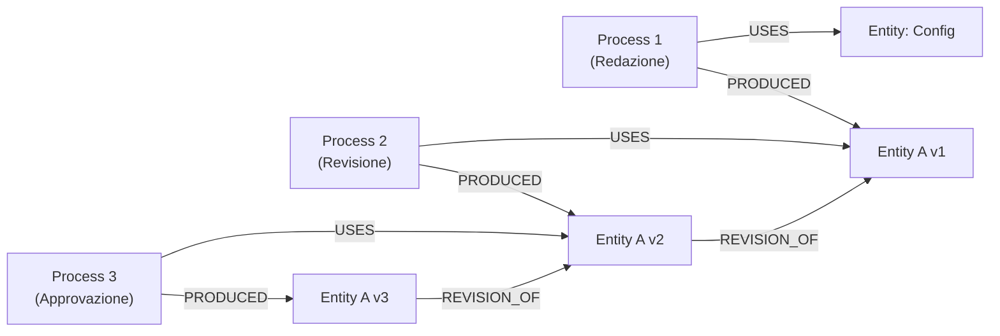

Ogni `REVISION_OF` collega la nuova versione dell'Entity a quella immediatamente precedente; il `SUPERSEDES` tra i Process traccia invece, separatamente, l'avanzamento del processo stesso. Le due catene — quella di versioning delle Entity e quella dei Process — avanzano in parallelo ma restano concettualmente distinte.

Il delta del cambiamento risponde alla netta separazione tra **Control Plane** (Process Metagraph) e **Data Plane** (Storage di dominio). Le due strategie operative con cui questo delta può essere fisicamente archiviato — **Delta Inline** e **Delta su Cold Storage** — insieme alle relative policy (soglie di dimensione, frequenza, reattività tramite watcher) sono dettagliate in **Appendice Tecnica B**, trattandosi di scelte a carattere implementativo.

---

## 9. Unificazione cross-dominio

Domini differenti non condividono i propri modelli dati interni, ma condividono lo **spazio degli identificatori canonici**. Due processi di reparti diversi si collegano in modo trasparente e transitivo referenziando la medesima Entity immutabile.

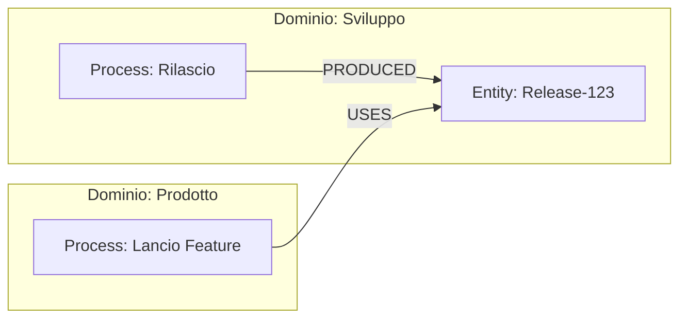

> **Nota applicativa — Cross-dominio Dev/Prodotto:** Il reparto Sviluppo produce `Entity: Release-123` al termine di un rilascio. Il reparto Prodotto, senza conoscere nulla dello schema interno di Sviluppo, referenzia la stessa Entity nel proprio Process "Lancio Feature". I due domini restano disaccoppiati nei modelli dati, ma transitivamente collegati tramite l'identificatore canonico condiviso.

---

## 10. Control Plane vs Data Plane

Il Process Metagraph agisce come **Control Plane**: un'infrastruttura ad alta velocità che contiene unicamente identificativi, archi, attributi dell'envelope e puntatori. Il contenuto effettivo (payload pesanti, log estesi di esecuzione, vettori, documenti) risiede nel **Data Plane**.

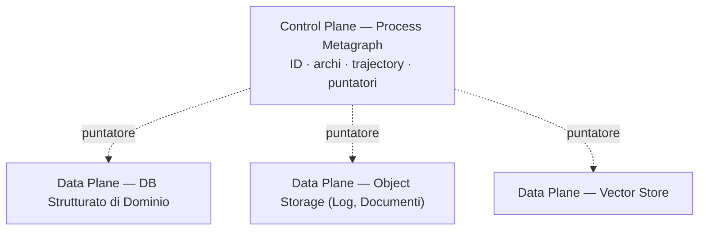

> **Nota applicativa — Integrazione con sistema legacy:** Un `EventHandler` (componente applicativo, fuori protocollo) osserva un evento di scrittura su un DB legacy HR. Legge il record modificato, lo mappa a un'Entity di dominio (`domain: HR`, `type: Contratto`) e scrive nel Control Plane solo l'envelope L1/L2 con puntatore; il contenuto integrale del record resta nel Data Plane (il DB legacy stesso, referenziato). Nessun payload pesante attraversa il Process Metagraph.

---

## 11. Envelope del Protocollo

Ogni transazione sul metagrafo avviene tramite un **Envelope** rigido nel tracciato L1, combinato con un payload L3 libero ma validato:

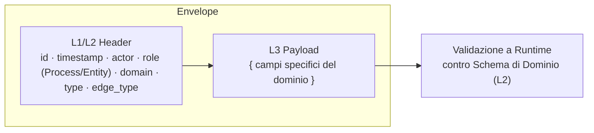

### 11.1 L'Envelope come Protocollo di Comunicazione

L'Envelope descritto sopra non è solo la forma di un nodo già scritto nel grafo: è anche il **formato del messaggio** con cui un sistema esterno (un `EventHandler` su un DB legacy, §10, un job scheduler, un altro modulo aziendale) comunica un'azione da compiere sul metagrafo. Non serve un secondo schema per i messaggi: lo stesso Envelope L1/L2/L3 vale sia per la persistenza sia per la comunicazione — coerentemente con quanto stabilito in §1.

La differenza è un solo campo aggiuntivo, presente solo sui messaggi in ingresso e non sui nodi già persistiti: `graph_action` — l'intento della richiesta (es. `CREATE_PROCESS`, `SUPERSEDES`, `ATTACH_ENTITY`). Il resto dell'header (id, timestamp, actor, domain, type) resta identico a quello di un nodo a riposo.

> **Nota applicativa:** Un `EventHandler` HR intercetta la firma di un contratto nel sistema legacy e invia un messaggio `{ graph_action: "SUPERSEDES", actor: "Mario", domain: "HR", type: "Contratto", payload: {...} }`. Il layer di ingestion del Control Plane lo interpreta e scrive il nuovo Process Node — l'handler non deve conoscere nulla della struttura interna del grafo oltre l'Envelope stesso.

---

## 12. Diritto all'Oblio e GDPR

In ottemperanza alle normative sul trattamento dei dati personali (es. GDPR Art. 17 - Diritto all'Oblio), l'immutabilità e la natura append-only del Process Metagraph sono bilanciate da precise garanzie nell'Actor Metagraph e nel Data Plane:

1. **Anonymization & Crypto-Shredding:** Nessun dato identificativo personale (PII) risiede in chiaro nei nodi del Process Metagraph. Gli identificativi degli attori fanno riferimento a entità dell'Actor Metagraph.
2. **Gestione del Diritto all'Oblio:** In caso di cancellazione di un utente, l'Actor Metagraph storicizza o anonimizza l'identità dell'attore (es. pseudonimizzazione o distruzione della chiave di cifratura associata), garantendo l'integrità strutturale del lineage storico per scopi di audit senza violare la legge.

> **Nota applicativa — Diritto all'oblio:** Un dipendente richiede la cancellazione dei propri dati. L'Actor Metagraph pseudonimizza l'identità dell'attore (o distrugge la chiave di cifratura associata) sostituendo i riferimenti PII; gli archi storici del Process Metagraph restano strutturalmente intatti e interrogabili in audit, senza esporre più l'identità reale.

---

## 13. Governance dei Domini

La governance degli schemi è decentralizzata per responsabilità ma controllata nell'esecuzione:

* **Responsabilità di Dominio:** Il Tech Lead o Dominio Owner definisce e fa evolvere gli schemi `(domain, role, type)` del proprio reparto e stabilisce le policy di archiviazione dei dati (L3).
* **Validazione ed Esecuzione:** La registrazione degli schemi nel registro di protocollo e le operazioni con privilegi sul metagrafo sono eseguite tramite meccanismi centralizzati che garantiscono la consistenza globale della rete.
* **Retrocompatibilità degli Schemi:** L'evoluzione di uno schema di dominio è sempre retrocompatibile con i vecchi dati: si può registrare una nuova versione dello schema affiancandola a quella precedente, o anche sostituirlo, ma tenendo presente che i vecchi dati ingeriti avevano un altro schema; uno schema esistente non viene mai rimosso né sostituito in modo distruttivo. I payload già validati contro versioni precedenti restano validi e interrogabili.

---

## 14. Sintesi dei Rischi e Mitigazioni Concettuali

| Rischio Concettuale | Mitigazione di Protocollo |
| --- | --- |
| Sovraccarico cognitivo da tracciamento agentico esteso | Proiezione separata: Macro-vista lineare (`SUPERSEDES`) per business/audit; Micro-vista (`SPAWN`/`FORK`) solo su richiesta. |
| Disallineamento tra Autorizzazione e Lineage | Actor Metagraph come Ground Truth: revoca immediata delle autorizzazioni alla fonte con firma univoca dell'attore sugli archi. |
| Incoerenza legale/GDPR in sistemi immutabili append-only | Pseudonimizzazione nell'Actor Metagraph e Crypto-Shredding dei payload sensibili nel Data Plane. |
| Sovraccarico del grafo di processo (Control Plane) | Separazione netta dal Data Plane: log agentici e payload complessi relegati a storage esterni referenziati. |
| Ambiguità nel tracciamento di esecuzioni concorrenti | Distinzione chiara tra convergenze di dati (`JOIN` tra Entity) e avanzamento temporale di processo (`SUPERSEDES`). |
| Confusione tra tracciamento fattuale e logica decisionale | Separazione concettuale tra Process Metagraph (COSA/CHI) e Memory Metagraph (PERCHE/COME); potenzialmente unificabili in sistemi interconnessi. |
| Indeterminismo su quale ramo è "vincitore" in processi divergenti | I branch rimangono tracciati come universi paralleli nel grafo. La decisione di convergenza avviene tramite JOIN su Entity, mai via SUPERSEDES tra branch. La scelta logica del ramo vincente risiede esclusivamente nella Memory Metagraph. |

---

## 15. Architettura della Memory Metagraph

La Memory Metagraph rappresenta lo strato logico-procedurale dell'infrastruttura APM. Mentre il Process Metagraph registra *cosa* è accaduto (il lineage fattuale), la Memory Metagraph cataloga *perché* è accaduto e *come* è stato deciso, fornendo il contesto logico e la traccia di ragionamento dietro ogni azione.

### 15.1 Responsabilità e Organizzazione

**[PLACEHOLDER: Descrivere i nodi principali della Memory Metagraph]**
- Goal e Objective: nodi che rappresentano intenzioni e target di un processo
- Procedure e Skill: nodi che codificano le procedure applicate e le competenze impiegate
- Decision Point: nodi che traccia le decisioni critiche e i loro razionali (es. quale branch è stato scelto e perché)
- Constraint e Principle: nodi che rappresentano vincoli applicati e principi di governance

### 15.2 Relazioni tra Memory Metagraph e Process Metagraph

**[PLACEHOLDER: Descrivere come la Memory Metagraph si collega al Process Metagraph]**
- Mappatura tra nodi Process e i relativi Objective/Goal nella Memory Metagraph
- Traccia delle procedure e skill applicate per ogni processo
- Registrazione del razionale dietro le decisioni contestate o divergenti (es. quale ramo è stato scelto e perché)
- Collegamento della logica esecutiva (commit hash, ref) alle procedure di evoluzione e ai principi che l'hanno guidata

### 15.3 Interrogazioni e Use Case

**[PLACEHOLDER: Elencare le interrogazioni tipiche sulla Memory Metagraph]**
- Auditing logico: "Quale principio ha guidato questa decisione?"
- Learning: "Quale skill è stata utilizzata in questo contesto?"
- Troubleshooting: "Quale era l'intento originale del processo?"
- Governance: "Quale procedura è stata violata?"
- Branch analysis: "Perché è stato scelto il branch A (commit abc) invece del branch B (commit def)?"

### 15.4 Potenziale Unificazione e Sistemi Interconnessi

**[PLACEHOLDER: Descrivere come Process e Memory Metagraph potrebbero essere parzialmente o totalmente integrate]**
- Opzione A: Integrazione completa in un grafo unificato
- Opzione B: Integrazione parziale tramite edge di referenza
- Opzione C: Mantenimento della separazione con sistema di linking esplicito

---

## 16. End-to-End Process Example

> **Nota:** Questo capitolo è una bozza segnaposto. Contiene un'idea iniziale di narrazione end-to-end, che verrà riscritta e ampliata direttamente dall'autore del manifesto.

Uno scenario base che attraversa tutti e tre i grafi: la revisione di un contratto legale con il supporto di un agente AI.

1. **Process Metagraph** — Un Process "Redazione Contratto" produce l'Entity `Contratto v1` (§6). Un secondo Process "Revisione Legale" la usa e, tramite `SPAWN`, delega a un agente l'analisi dei rischi contrattuali (§7); l'agente produce `Contratto v2`, collegata alla precedente tramite `REVISION_OF` (§8).
2. **Actor Metagraph** — Ogni arco `SUPERSEDES`/`USES`/`PRODUCED` porta l'`actor` che ha firmato l'azione (l'avvocato titolare, l'agente in delega). Se la titolarità del contratto passa da un legale a un altro, l'Actor Metagraph riflette il trasferimento senza alterare la storia già scritta (§4).
3. **Memory Metagraph** — Il "perché" dietro la scelta di delegare l'analisi rischi a un agente, il principio di governance che lo autorizzava, e il razionale con cui è stata approvata la v2 restano catalogati qui (§15), non nel Process Metagraph.

Un'idea di unificazione parziale (Opzione B di §15.4): il Process "Revisione Legale" porta un arco di referenza esplicito verso il nodo Decision Point nella Memory Metagraph che ne motiva l'esito, senza fondere i due grafi in uno unico. Questo permette di interrogare "cosa è stato fatto" e "perché è stato fatto" separatamente, ma di navigare dall'uno all'altro quando serve un audit completo.

---

## 17. Chiusura

APM v4.1 si conferma come una **architettura minimale e concettualmente solida**: tre grafi con responsabilità distinte, un metamodello a sole due primitive fisiche (`Process` ed `Entity`), e un modello di tracciamento che bilancia la flessibilità dell'orchestrazione agentica con la chiarezza richiesta dai processi aziendali.

Ogni **Process è simultaneamente sia l'azione che l'ancoraggio alla logica esecutiva**: il commit hash, il ref, la versione della procedura. Nessuna separazione artificiale: il versioning della logica è inscindibile dal versioning del processo. Modifiche al codice creano naturalmente nuovi Process via SUPERSEDES.

Il Process Metagraph, stateless per natura, traccia il *cosa* e il *chi*; la Memory Metagraph emerge come pilastro parallelo per il *perché* e il *come*. I processi evolutivi divergenti rimangono tracciati come universi indipendenti nel grafo, evitando false connessioni e preservando la chiarezza decisionale. Insieme, ma concettualmente separabili, danno forma a un sistema di osservabilità integrata.

Lasciando al manuale tecnico la definizione dei driver di storage, dei motori di database a grafo (es. modellazione tramite property graph / hyperedge) e delle chiavi di protocollo, il manifesto fissa **i principi invarianti** su cui costruire la collaborazione trasparente e sicura tra persone e intelligenze artificiali.

---
---

# Appendice Tecnica

> I contenuti che seguono sono di natura implementativa e di dettaglio. Sono riferiti dal Corpo Principale tramite i rimandi §7.1 e §8, e sono pensati per chi debba progettare, implementare o auditare il sistema nel dettaglio (AI Engineer, architetti, revisori tecnici).

## Appendice Tecnica A — Ancoraggio del Process alla Logica Esecutiva: dettagli, ramificazioni e rollback (rif. §7.1)

Riprendendo la struttura del Supersession Graph (§5), vediamo ora un esempio più articolato in cui ogni Process è ancorato anche all'evoluzione della logica sottostante.

Ogni Process Node è **indissolubilmente ancorato a uno stato di logica esecutiva**: il codice, lo script, la procedura o la codebase che lo governa. Questo ancoraggio non è una Entity separata, ma è il Process stesso che lo rappresenta.

### Tracciamento dell'Evoluzione della Logica

Quando la logica cambia (es. lo script viene modificato, il commit hash della codebase avanza, la procedura si evolve), questo cambiamento è registrato tramite un nuovo arco `SUPERSEDES` che rappresenta simultaneamente:
1. **L'avanzamento dell'attività** (cosa è stato fatto)
2. **L'evoluzione della logica** che l'ha governata (commit hash, ref, versione della procedura)

Esempio con una codebase su Git:

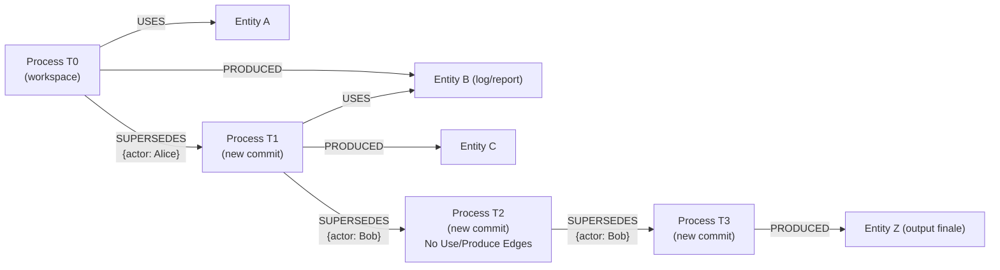

NOTA: L'Entity Management avviene anche con ausilio di agenti, non sono stati integrati a scopo dimostrativo, anche le modifiche al process possono essere evolute con ausilio di agenti AI.

### Caso di ramificazione: Processi evolutivi indipendenti

Quando da un Process divergono **molteplici rami `SUPERSEDES`** (rollback, branch paralleli, direzioni alternative), ciascun ramo costituisce un **processo evolutivo indipendente**:

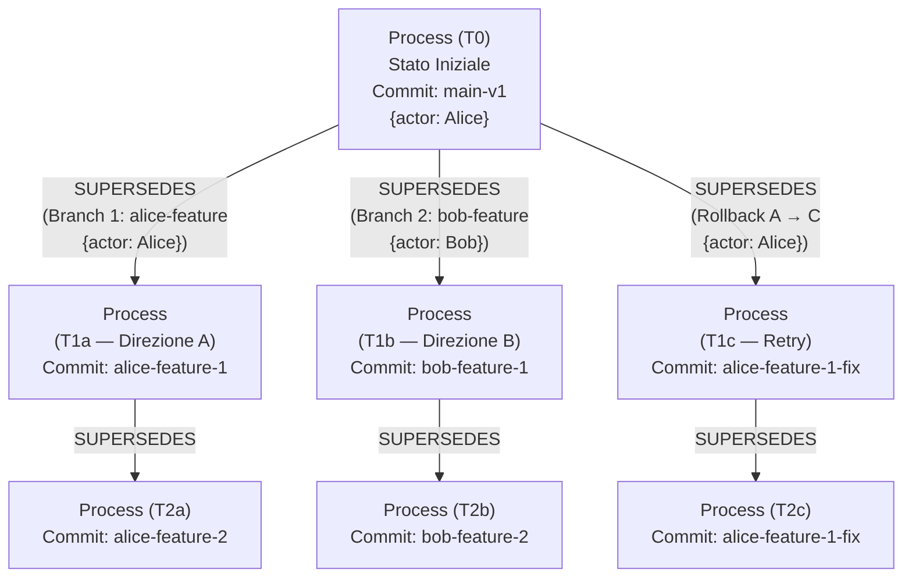

**Caratteristiche dei processi evolutivi indipendenti:**

1. **Non unificabili tramite SUPERSEDES:** Due branch divergenti rimangono tracciati come rami paralleli ma **non possono essere connessi tramite edge `SUPERSEDES`**. Non esiste un arco diretto A → B o B → A. Rimangono "universi paralleli" nel grafo.

2. **Condivisione controllata di Entity:** I rami paralleli possono **utilizzare la medesima Entity ausiliaria** se concordato dal dominio (es. leggere la medesima configurazione, accedere allo stesso storage di condivisione). Tuttavia, questa condivisione è regolata da policy esplicite di sincronizzazione e non implica alcuna relazione temporale tra i branch.

3. **Convergenza opzionale tramite `JOIN`:** Se due branch debbono riconvergere, la convergenza avviene **esclusivamente tramite l'arco `JOIN` su Entity**, che consolida gli artefatti prodotti dai rami. Non è mai un arco `SUPERSEDES` diretto tra i Process dei due branch.

4. **Decisione logica delegata alla Memory Metagraph:** Il Process Metagraph **non registra quale branch è stato "scelto" come vincitore**. Questa decisione è esclusiva della Memory Metagraph e della logica di business: lì si cataloga il razionale (PERCHE) di quale direzione è stata adottata e come è stata comunicata la decisione.

**Implicazione per la logica esecutiva:** Quando i rami divergono, ogni branch segue una propria evoluzione di logica (commit hash, ref, versione di procedura) **indipendente e parallela** senza sincronizzazione automatica con gli altri rami. Rimangono tracce separate e rintracciabili.

> **Nota applicativa — Pipeline di training ML:** Ogni esecuzione di training è un Process ancorato al commit hash della codebase. Un retry dopo un fallimento non modifica il Process esistente: crea un nuovo Process via `SUPERSEDES`, ancorato all'eventuale nuovo commit (fix di un bug nello script) o allo stesso commit (retry puro). Il checkpoint prodotto è un'Entity `PRODUCED`; le metriche di training sono un'altra Entity, referenziata via puntatore al Data Plane (es. storage dei log).

---

## Appendice Tecnica B — Strategie di Delta Storage: Inline vs Cold Storage (rif. §8)

Il delta del cambiamento risponde alla netta separazione tra **Control Plane** (Process Metagraph) e **Data Plane** (Storage di dominio):

* **Delta Inline (Control Plane):** Per variazioni strutturali minime e metadati compatti, il delta risiede direttamente sull'arco nel metagrafo.
* **Delta in Cold Storage (Data Plane):** Per modifiche estese o documenti complessi, l'arco contiene la relazione logica e il puntatore ai dati nello storage esterno.

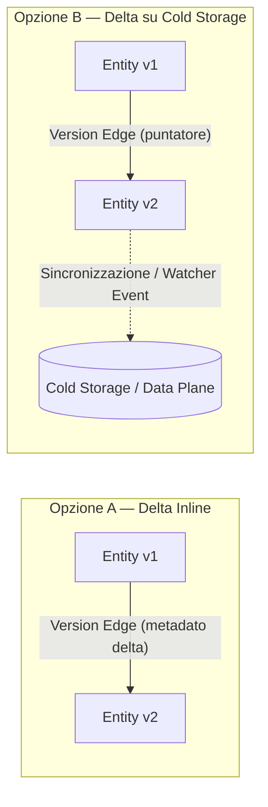

Le policy su dove archiviare i delta (soglie di dimensione, frequenza) e l'eventuale reattività tramite watcher ed eventi di sistema sono scelte operative definite nel manuale tecnico in base ai requisiti dell'infrastruttura software adottata.

---

## Appendice Tecnica C — Standard di Riferimento e Terminologia

Il vocabolario e alcuni principi architetturali di APM si appoggiano a standard e pattern già consolidati nel settore. Questa appendice ne raccoglie i riferimenti essenziali per chi non li conoscesse.

| Standard / Pattern | Cosa fornisce ad APM | Riferimento |
| --- | --- | --- |
| **PROV-O** (W3C Provenance Ontology) | Il modello concettuale Entity–Activity–Agent, riletto in APM come Entity–Process–Actor (§0, §3). | https://www.w3.org/TR/prov-o/ |
| **Reactive Manifesto** | I principi di elasticità, resilienza e reattività agli eventi che ispirano l'architettura a grafi disaccoppiati (§0, §2). | https://www.reactivemanifesto.org/ |
| **Event Sourcing** | Il pattern di stato immutabile e versionato, alla base della natura append-only del Process Metagraph (§0, §7.2). | https://martinfowler.com/eaaDev/EventSourcing.html |
| **Schema Registry** (es. Confluent Schema Registry) | Il pattern di registrazione centralizzata degli schemi di dominio con evoluzione controllata e retrocompatibile (§13). | https://docs.confluent.io/platform/current/schema-registry/index.html |
| **RBAC / ABAC** (Role-Based / Attribute-Based Access Control) | I modelli di controllo accessi su cui si fonda l'Actor Metagraph come Ground Truth di identità e permessi (§2). | https://csrc.nist.gov/projects/role-based-access-control |
| **GDPR** (Regolamento UE 2016/679) | Il quadro normativo per la protezione dei dati personali, in particolare l'Art. 17 (Diritto all'Oblio) affrontato in §12. | https://eur-lex.europa.eu/eli/reg/2016/679/oj |